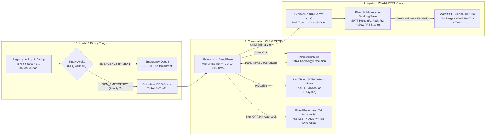

# HPMS (Hospital & Patient Healthcare Management System) — Design System Master (`MASTER.md`)

**Version:** 3.1.0 (SRS `10/26/2026` Aligned)  
**Skill Engine:** `ui-ux-pro-max` (Healthcare EMR + Accessible & Ethical + Data-Dense Dashboard + Swiss Modernism 2.0)  
**Compliance:** Circular No. 46/2018/TT-BYT • Circular No. 54/2017/TT-BYT • WHO ICD-10 • WCAG 2.2 AA/AAA  
**Frontend Stack:** React 19 • TypeScript • Vite • Tailwind CSS v4 (`@tailwindcss/vite`) • React Router v7 • `lucide-react` SVG Icons

> **HIERARCHICAL GOVERNANCE (Master + Overrides Pattern):**  
> When building or updating a specific screen, **always check `design-system/pages/<page-name>.md` first**:
> - [`auth-mfa.md`](./pages/auth-mfa.md) — Multi-Role Login, Mandatory TOTP MFA, Recovery Codes & Inactivity Lock (`REQ-AUTH-01..05`)
> - [`emergency-triage.md`](./pages/emergency-triage.md) — Patient Registry, `BN-YY-xxxx` Intake, Binary Acuity Triage & Audited 30s PII Unmask (`REQ-ADM-01..03, 05..06`)
> - [`clinical-workstation.md`](./pages/clinical-workstation.md) — Department-Scoped Consultation, Sub-500ms ICD-10 Search, CPOE 3-Tier Drug Safety, Replacement Lineage & Addendum (`REQ-EXAM-01..07`, `REQ-PRES-01..07`)
> - [`nurse-vitals-monitor.md`](./pages/nurse-vitals-monitor.md) — Non-Blocking Bedside Vitals, Single-Parameter Track & Trigger (SPTT), Real-Time SSE Stream & Ward Bed State Machine (`REQ-REC-01..04`, `REQ-INCARE-01..05`)
> - [`paraclinical-workstation.md`](./pages/paraclinical-workstation.md) — Laboratory (`XetNghiem`) & Radiology (`ChanDoanHinhAnh`) Worklists, Multi-Format Media Upload (`<= 256MB` Nginx stream, SRS dynamic admin limits) & Atomic Order Closure (`REQ-PARAC-01..04`)
> - [`patient-portal.md`](./pages/patient-portal.md) — Read-Only Longitudinal Health Record (`HoSoSucKhoe`) & Encounter Summary Portal (`REQ-ADM-04..05`)
> - [`admin-operations.md`](./pages/admin-operations.md) — 6 Core Reports (`RPT-01..06`), Append-Only Audit Trail, Grounded Monthly AI Summary & Facility Governance (`REQ-REPORT-01A..06`)
>
> If a page override file exists, its specialized rules **override** this Master file. Otherwise, strictly follow `MASTER.md`.

---

## Table of Contents
1. [Design Philosophy & Style Synthesis](#1-design-philosophy--style-synthesis)
2. [Color Palette & Semantic Tokens](#2-color-palette--semantic-tokens)
3. [Typography System](#3-typography-system)
4. [Border Radius Scale](#4-border-radius-scale)
5. [Spacing, Sizing & Layout Grid System](#5-spacing-sizing--layout-grid-system)
6. [Borders, Dividers & Elevation (Shadows)](#6-borders-dividers--elevation-shadows)
7. [Iconography, Motion, Z-Index & Data Visualization](#7-iconography-motion-z-index--data-visualization)
8. [Component Specifications (CSS & Tailwind v4 Recipes)](#8-component-specifications-css--tailwind-v4-recipes)
9. [SRS Clinical Guardrails, Workflow & Pre-Delivery Checklist](#9-srs-clinical-guardrails-workflow--pre-delivery-checklist)

---

## 1. Design Philosophy & Style Synthesis

HPMS is a mission-critical hospital EMR and patient portal engineered for **1080p+ clinical workstations** (`ASM-02`), bedside nursing tablets, and consumer mobile/desktop browsers. Synthesizing recommendations from `ui-ux-pro-max`, the visual language blends three complementary disciplines:

1. **Accessible & Ethical Foundation (WCAG 2.2 AA/AAA)**:
   - Contrast ratio **>= 7:1** for physiological vital signs, emergency alerts, and patient identifiers; **>= 4.5:1** minimum for body copy, form labels, and secondary metadata.
   - **Triple-Redundant Signaling**: Never convey clinical state through color alone. Every alert, bed status, or drug safety tier MUST combine **Color + Border/Surface Treatment + `lucide-react` SVG Icon + Explicit Text Label**.
2. **Data-Dense Dashboard + Swiss Modernism 2.0**:
   - Disciplined **12-column CSS Grid** built on an **8px spatial modulus**, prioritizing crisp `1px` structural borders (`#E2E8F0`) over heavy decorative drop shadows so physicians can scan allergies, vitals, labs, and prescriptions above the fold without scroll fatigue.
3. **Role-Adaptive Density & Dual Lighting Modes**:
   - **Compact Clinical Density** (`36px–38px` controls/rows, `14px` body) for Doctors, Receptionists, Paraclinical Technicians, and Admins.
   - **Touch & Accessible Density** (`48px` controls/rows, `16px` body) for Bedside Nurses on ward rounds and Elderly Patients using the Self-Service Web Portal.
   - **Light Clinical Mode** (default bright outpatient clinics & offices) + **Night Duty Mode** (`[data-theme="night-duty"]` low-glare slate surfaces for 24/7 Emergency & Inpatient Nursing Stations).

---

## 2. Color Palette & Semantic Tokens

### 2.1 Core Brand & Interactive Palette (`ui-ux-pro-max` Clinical Cyan + Health Emerald)

| Role | Token / CSS Variable | Hex | Contrast (on `#FFFFFF`) | Primary UI Usage |
|:---|:---|:---|:---|:---|
| **Brand Primary** | `--color-brand-primary` | `#0891B2` | `3.7:1` (Large UI / Ring) | `:focus-visible` rings, active tab indicators, selected card borders, primary icons |
| **Brand Deep** | `--color-brand-deep` | `#0E7490` | `5.4:1` (WCAG AA) | Primary navigation actions (`bg-brand-deep text-white`), active sidebar pills, links |
| **Brand Dark** | `--color-brand-dark` | `#164E63` | `9.2:1` (WCAG AAA) | High-emphasis clinical headers, institutional branding text |
| **Brand Surface** | `--color-brand-surface` | `#ECFEFF` | — | Selected table row fill, active patient context banner background |
| **Brand Secondary** | `--color-brand-secondary`| `#0284C7` | `4.1:1` (`#0369A1` text `5.9:1`) | Informational tags, RxCheck external source badges, secondary chart series |
| **Primary CTA** | `--color-cta` | `#059669` | `3.8:1` (use `#047857` text/hover) | Final clinical commit buttons (*Save Vitals*, *Lock Prescription*, *Complete Exam*) |
| **Primary CTA Hover**| `--color-cta-hover` | `#047857` | `5.5:1` (WCAG AA) | Hover/active state for primary clinical commit buttons |

### 2.2 Neutral Surfaces, Borders & Text Hierarchy (Light vs. Night Duty Mode)

| Semantic Token | Light Clinical (`:root`) | Contrast (Light) | Night Duty (`[data-theme="night-duty"]`) | Contrast (Night) | Usage |
|:---|:---|:---|:---|:---|:---|
| `--surface-canvas` | `#F8FAFC` (`slate-50`) | — | `#0B1120` (`slate-950`) | — | Root application background behind cards/panels |
| `--surface-card` | `#FFFFFF` (`white`) | — | `#111827` (`gray-900`) | — | Primary cards, tables, forms, modals |
| `--surface-subtle` | `#F1F5F9` (`slate-100`) | — | `#1E293B` (`slate-800`) | — | Sticky table headers, secondary wells, locked record background |
| `--surface-elevated` | `#FFFFFF` | — | `#1E293B` (`slate-800`) | — | Dropdown menus, autocomplete popovers, floating banners |
| `--border-subtle` | `#E2E8F0` (`slate-200`) | — | `#334155` (`slate-700`) | — | Standard `1px` card outlines, table row dividers |
| `--border-strong` | `#CBD5E1` (`slate-300`) | — | `#475569` (`slate-600`) | — | Form input borders, button outlines, locked record borders |
| `--text-primary` | `#0F172A` (`slate-900`) | `15.8:1` (AAA) | `#F8FAFC` (`slate-50`) | `16.4:1` (AAA) | Patient names, vital values, primary clinical notes, headings |
| `--text-secondary` | `#334155` (`slate-700`) | `10.8:1` (AAA) | `#CBD5E1` (`slate-300`) | `10.9:1` (AAA) | Form labels, table cell text, secondary metadata |
| `--text-muted` | `#475569` (`slate-600`) | `7.5:1` (AAA) | `#94A3B8` (`slate-400`) | `5.8:1` (AA) | Timestamps, helper captions, units (`mmHg`, `bpm`, `%`) |
| `--text-disabled` | `#94A3B8` (`slate-400`) | `2.8:1` (Exempt)| `#64748B` (`slate-500`) | `3.1:1` (Exempt)| Disabled controls only (**never** use for readable clinical data) |

### 2.3 General UI Feedback States

| State | Text / Icon | Surface Bg | Border | Lucide Icon | Usage |
|:---|:---|:---|:---|:---|:---|
| **Success** | `#065F46` | `#ECFDF5` | `#10B981` | `CheckCircle2` | `201 Created` vital save toast, completed lab upload, MFA verified |
| **Warning** | `#92400E` | `#FFFBEB` | `#F59E0B` | `AlertTriangle` | Session lock 60s countdown warning, SSE reconnecting state, duplicate patient hint |
| **Error / Danger** | `#991B1B` | `#FEF2F2` | `#EF4444` | `XCircle` | Form validation error, failed API mutation, account lockout (`423 Locked`) |
| **Info** | `#075985` | `#F0F9FF` | `#0284C7` | `Info` | Read-only system notices, audit export progress, recovery code instructions |

### 2.4 Single-Parameter Track & Trigger (SPTT) Vital Alert Palette (`REQ-REC-02`)

> **SRS Rule:** HPMS evaluates 6 physiological parameters (`Mach`, `TamThu`, `TamTruong`, `NhietDo`, `NhipTho`, `SpO2`) independently. **Never** render `NEWS2`/`MEWS` composite numeric scores.

| SPTT State | Token Prefix | Text / Icon | Surface Bg | Border / Halo | Required Icon + Badge | Clinical Trigger |
|:---|:---|:---|:---|:---|:---|:---|
| **`RED_ALERT` (R1)** | `--color-sptt-red-*` | `#B91C1C` | `#FEF2F2` | `#DC2626` (`2px` + pulse halo) | `Siren` • `[RED] CRITICAL` | `>= 1` parameter in Red range; immediate SSE (`<= 2.0s`) + audio chime; bypasses 15m cooldown on Yellow -> Red escalation |
| **`YELLOW_ALERT` (R2)**| `--color-sptt-yellow-*` | `#92400E` | `#FFFBEB` | `#D97706` (`2px` solid) | `AlertTriangle` • `[YELLOW] CAUTION` | `0` Red AND `>= 2` parameters in Yellow range (also used for single abnormal cell highlight) |
| **`STABLE` (R3)** | `--color-sptt-stable-*` | `#065F46` | `#ECFDF5` | `#10B981` (`1px` solid) | `CheckCircle2` • `STABLE` | `0` Red AND `< 2` Yellow parameters |
| **`INCOMPLETE`** | `--color-sptt-incomplete-*`| `#334155` | `#F1F5F9` | `#94A3B8` (`1.5px dashed`) | `FileQuestion` • `INCOMPLETE VITALS` | `>= 1` required vital omitted; never treated as `0` or `Normal` |
| **`COOLDOWN (15m)`** | — | `#475569` | `#F8FAFC` | `#CBD5E1` (`1px` solid) | `BellOff` • `COOLDOWN 15m` | Duplicate patient + parameter + severity suppressed within `< 15 min` while live numbers update |

### 2.5 CPOE 3-Tier Pharmacotherapy Safety Palette (`REQ-PRES-03..05`)

| Safety Tier | Token Prefix | Text / Icon | Surface Bg | Border | Mandatory Gatekeeper Behavior |
|:---|:---|:---|:---|:---|:---|
| **Allergen / Major (`NghiemTrong`)** | `--color-cpoe-block-*` | `#991B1B` | `#FEF2F2` | `#DC2626` (`2px solid`) | **HARD BLOCK (`Chan`)**: Lock button disabled (`disabled`); zero override button; offending drug must be removed/replaced |
| **Moderate (`TrungBinh`)** | `--color-cpoe-moderate-*`| `#9A3412` | `#FFF7ED` | `#EA580C` (`1.5px solid`)| **JUSTIFICATION (`CanhBao`)**: Requires mandatory `LyDoLamSang` (`10–500` chars) before prescription lock |
| **Minor (`Nhe`)** | `--color-cpoe-minor-*` | `#075985` | `#F0F9FF` | `#0284C7` (`1px solid`) | **ADVISORY (`ChoPhep`)**: Non-blocking inline badge; physician can lock without justification |

### 2.6 Ward Bed Finite State Machine Palette (`REQ-INCARE-02`)

| Bed Status (`TrangThaiGiuong`) | Token Prefix | Text / Badge | Surface Bg | Border | Icon & Display Rules |
|:---|:---|:---|:---|:---|:---|
| **`Trong` (Available — Green)** | `--color-bed-available-*` | `#065F46` | `#ECFDF5` | `#10B981` | `CheckCircle` • Selectable for new inpatient admission (`BenhAnNoiTru`) |
| **`DangSuDung` (Occupied — Blue)** | `--color-bed-occupied-*` | `#1E40AF` | `#EFF6FF` | `#2563EB` | `BedDouble` • Shows Patient Name, `BN-YY-xxxx`, `BacSiPhuTrach`. Wrapped by outer Yellow/Red SPTT halo if active `CanhBaoYTe` exists |
| **`BaoTri` / `ChoKhuKhuan` (Gray)**| `--color-bed-maintenance-*`| `#334155` | `#F1F5F9` | `#94A3B8` | `Sparkles` / `Wrench` • Subtle diagonal stripe pattern; disabled for admission until nurse marks sanitized |

### 2.7 Authoritative SRS Role Badges (`SEC-RBAC-01`)

| JWT `VaiTro` | Role Name (EN / VI) | Token Prefix | Text | Surface Bg | Border | Lucide Icon | Idle Auto-Lock |
|:---|:---|:---|:---|:---|:---|:---|:---|
| `Admin` | Facility Admin (*Quản trị viên*) | `--color-role-admin-*` | `#1E293B` | `#F1F5F9` | `#CBD5E1` | `ShieldCheck` | **10 min** |
| `BacSi` | Doctor (*Bác sĩ*) | `--color-role-doctor-*` | `#0E7490` | `#ECFEFF` | `#A5F3FC` | `Stethoscope` | **15 min** |
| `DieuDuong` | Nurse (*Điều dưỡng*) | `--color-role-nurse-*` | `#0F766E` | `#F0FDFA` | `#99F6E4` | `HeartPulse` | **15 min** |
| `NhanVienTiepDon` | Receptionist (*NV Tiếp đón*) | `--color-role-receptionist-*`| `#1D4ED8` | `#EFF6FF` | `#BFDBFE` | `IdCard` | **15 min** |
| `KyThuatVienCLS` | CLS Technician (*KTV Cận lâm sàng*) | `--color-role-paraclinical-*`| `#0369A1` | `#F0F9FF` | `#BAE6FD` | `FlaskConical`| **15 min** |
| `Patient` | Patient (*Bệnh nhân*) | `--color-role-patient-*` | `#047857` | `#ECFDF5` | `#A7F3D0` | `UserCheck` | **15 min** |

---

## 3. Typography System

### 3.1 Font Families (`ui-ux-pro-max` Vietnamese Clinical Pairing)

- **Heading & UI Control Font (`--font-heading`)**: **`Be Vietnam Pro`** — Purpose-built geometric sans-serif with generous vertical headroom so stacked Vietnamese tonal marks (*dấu sắc, huyền, hỏi, ngã, nặng* combined with *ă, â, ê, ô, ơ, ư*) never clip or collide inside compact `36px` buttons and table headers.
- **Clinical Narrative & Patient Portal Body (`--font-sans`)**: **`Noto Sans`** — Neutral, ultra-legible humanist sans-serif optimized for long-form chief complaints (`LyDoKham`), clinical progress notes (`DienBienBenh`), and `16px` elderly-friendly patient instructions (`LoiDanBacSi`).
- **Telemetry, Codes & PII Monospace (`--font-mono`)**: **`JetBrains Mono`** — Slashed zero (`0` vs `O`) and clear `1` vs `l` vs `I` differentiation for `BN-YY-xxxx` IDs, ICD-10 codes (`I10`, `J18.9`), live vital signs, masked PII (`079xxxxxx123`), 6-digit TOTP codes, and `SHA-256` audit hashes.

**Google Fonts Import (`index.html`):**
```html
<link rel="preconnect" href="https://fonts.googleapis.com" />
<link rel="preconnect" href="https://fonts.gstatic.com" crossorigin />
<link
  href="https://fonts.googleapis.com/css2?family=Be+Vietnam+Pro:wght@500;600;700&family=JetBrains+Mono:wght@400;500;600;700&family=Noto+Sans:wght@400;500;600;700&display=swap"
  rel="stylesheet"
/>
```

### 3.2 Modular Type Scale

| Type Token | Font Family | Size (`px` / `rem`) | Weight | Line Height | Letter Spacing | Target UI Elements |
|:---|:---|:---|:---|:---|:---|:---|
| `display-xl` | `Be Vietnam Pro` | `32px` / `2.0rem` | `700` | `1.20` (`38.4px`) | `-0.02em` | Waiting room queue callout (`SoThuTu`), login brand title |
| `display-kpi` | `Be Vietnam Pro` | `28px` / `1.75rem` | `700` | `1.20` (`33.6px`) | `-0.015em` | Ward census KPIs, Admin `RPT-01..06` summary figures |
| `heading-page` (`h1`) | `Be Vietnam Pro` | `20px` / `1.25rem` | `600` | `1.30` (`26px`) | `-0.01em` | Page workspace header, active patient banner name (`HoTen`) |
| `heading-section` (`h2`)| `Be Vietnam Pro` | `16px` / `1.0rem` | `600` | `1.35` (`21.6px`) | `-0.005em` | Card headers, modal titles, clinical form section dividers |
| `heading-card` (`h3`) | `Be Vietnam Pro` | `14px` / `0.875rem` | `600` | `1.40` (`19.6px`) | `0em` | Sub-panel headers, bed card number, timeline encounter title |
| `body-patient` | `Noto Sans` | `16px` / `1.0rem` | `400/500`| `1.60` (`25.6px`) | `0em` | **Patient Portal (`REQ-ADM-04`)** body copy & medication instructions |
| `body-clinical` | `Noto Sans` | `14px` / `0.875rem` | `400/500`| `1.50` (`21px`) | `0em` | **Default Staff Body**: Symptoms, clinical notes, table cell text, inputs |
| `label-ui` | `Be Vietnam Pro` | `13px` / `0.8125rem`| `600` | `1.35` (`17.5px`) | `0.005em` | Form `<label>`, button labels, status pills, table `<th>` headers |
| `caption-meta` | `Noto Sans` | `12px` / `0.75rem` | `400/500`| `1.40` (`16.8px`) | `0.01em` | Helper text, field validation hints, unit labels (`mmHg`, `°C`, `L/min`) |
| `mono-vital-lg` | `JetBrains Mono` | `22px` / `1.375rem` | `700` | `1.20` (`26.4px`) | `-0.02em` | Large bedside vital telemetry readouts (`SpO2 88%`, `HR 132`) |
| `mono-data` | `JetBrains Mono` | `13px` / `0.8125rem`| `500/600`| `1.35` (`17.5px`) | `0em` | `BN-26-0001`, ICD-10 `[I10]`, masked PII `079xxxxxx123`, timestamps |
| `mono-xs` | `JetBrains Mono` | `11px` / `0.6875rem`| `500` | `1.35` (`14.8px`) | `0.01em` | `SHA-256` file integrity digests, audit correlation IDs, `<kbd>` hints |

### 3.3 Typography Engineering Rules
1. **Mandatory Tabular Numerals (`.tabular-nums`)**: Every numeric readout, vital sign, lab value, countdown timer (`30s` PII re-mask, `15m` session lock), and table timestamp MUST set `font-variant-numeric: tabular-nums` so live SSE updates never shift horizontal column widths.
2. **Vietnamese Diacritic Clearance**: Never set `line-height < 1.3` on headings or `overflow: hidden` without vertical padding (`py-0.5`) on single-line badges containing uppercase Vietnamese characters (e.g., `ĐANG SỬ DỤNG`, `CẢNH BÁO ĐỎ`).
3. **Optimal Measure**: Constrain free-text clinical notes (`DienBienBenh`, `TomTatBenhAn`, Monthly AI Summary) to `65ch–80ch` max-width for effortless reading.

---

## 4. Border Radius Scale

HPMS balances **Swiss clinical precision** (sharp enough for dense tabular workspaces) with **human-centered approachability** (softened corners on cards, modals, and Patient Portal surfaces). Avoid extreme brutalist `0px` cards or overly playful `24px+` consumer bubbles on clinical panels.

| Radius Token | Value (`px` / `rem`) | Tailwind Utility | Assigned UI Components |
|:---|:---|:---|:---|
| `--radius-none` | `0px` | `rounded-none` | Full-bleed sticky top header (`56px`), sidebar rail edge, data table `<tr>` rows |
| `--radius-xs` | `4px` / `0.25rem` | `rounded-xs` / `rounded-[4px]` | Inline monospace code tags (`[I10]`, `BN-26-0001`), `<kbd>` shortcut hints, checkboxes |
| `--radius-sm` | `6px` / `0.375rem` | `rounded-sm` / `rounded-[6px]` | Compact table filter chips, dense `36px` inline table inputs, segmented control items, tooltips |
| `--radius-md` | `8px` / `0.5rem` | `rounded-md` / `rounded-lg` | **Default Interactive Radius**: All standard buttons, form inputs, `<select>`, `<textarea>`, dropdown menus, toast notifications |
| `--radius-lg` | `12px` / `0.75rem` | `rounded-xl` | **Default Container Radius**: Clinical panels, Ward Bed cards (`GiuongBenh`), KPI metric cards, inline alert banners, Patient Portal cards |
| `--radius-xl` | `16px` / `1.0rem` | `rounded-2xl` | Modal dialogs (CPOE Drug Safety, Post-Lock Addendum, MFA Setup, CLS Media Viewer), floating SSE emergency banners, Login card |
| `--radius-full` | `9999px` | `rounded-full` | Role + Department scope pills, SPTT status badges, Live SSE dot/pill, circular icon buttons, avatars, toggle switches |

> **Concentric Nested Radius Rule:** When nesting a child element inside a padded container (e.g., an action box inside a `12px` `--radius-lg` card with `4px–6px` tight padding, or a footer inside a `16px` `--radius-xl` modal), step down one radius token (`12px` outer -> `8px` inner; `8px` outer segmented group -> `6px` inner active tab) so corners align optically.

---

## 5. Spacing, Sizing & Layout Grid System

### 5.1 `8px` Modular Spacing Scale (`--space-*`)

| Spacing Token | Value (`px` / `rem`) | Tailwind Class | Clinical Layout Usage |
|:---|:---|:---|:---|
| `--space-0` | `0px` | `0` | Flush table borders and sticky headers |
| `--space-2xs` | `2px` / `0.125rem` | `0.5` | Tight vertical gap between value and unit (`120` + `mmHg`) |
| `--space-xs` | `4px` / `0.25rem` | `1` | Icon-to-text gap inside compact badges and inline code pills |
| `--space-sm` | `8px` / `0.5rem` | `2` | **Base Modulus**: Dense clinical grid gap (`gap-2`), button icon gap, compact cell padding |
| `--space-md` | `12px` / `0.75rem` | `3` | Compact clinical card padding (`p-3`), input horizontal padding (`px-3`), form field stack gap |
| `--space-base` | `16px` / `1.0rem` | `4` | Standard panel padding (`p-4`), standard grid gap (`gap-4`), modal body padding |
| `--space-lg` | `24px` / `1.5rem` | `6` | Patient Portal card padding (`p-6`), major workspace section separation, modal desktop padding |
| `--space-xl` | `32px` / `2.0rem` | `8` | Page header to content separation on Patient Portal & Admin analytics dashboards |
| `--space-2xl` | `48px` / `3.0rem` | `12` | Empty-state vertical padding, login/MFA centered card breathing room |
| `--space-3xl` | `64px` / `4.0rem` | `16` | Full-screen lock screen / major portal hero vertical spacing |

### 5.2 Interactive Control Sizing Matrix

| Density Profile | Target Roles / Screens | Input / Button Height | Table Row Height | Horizontal Padding | Font Size |
|:---|:---|:---|:---|:---|:---|
| **Compact (`sm`)** | `BacSi` 3-pane consult, `KyThuatVienCLS`, `Admin` tables | `36px` (`h-9`) | `38px` | `12px` (`px-3`) | `13px–14px` |
| **Standard (`md`)** | `NhanVienTiepDon` intake forms, Login/MFA, Modals | `40px` (`h-10`) | `44px` | `16px` (`px-4`) | `14px` |
| **Touch / Portal (`lg`)**| `DieuDuong` bedside tablet vitals, `Patient` Web Portal | `48px` (`h-12`) | `48px–52px` | `18px–20px` (`px-5`)| `15px–16px` |

> **Touch Target Requirement:** On tablet (`<= 1024px`) and Patient Portal screens, every interactive control (including icon buttons like PII `Eye` unmask or modal `X` close) MUST provide at least a **`44x44px`** hit area (`48x48px` preferred) with `>= 8px` gap between adjacent targets.

### 5.3 Application Shell & Responsive Breakpoints

- **Top Global Header**: Fixed `56px` height (`h-14`), `1px` bottom border (`var(--border-subtle)`), containing Facility Title, Active Department Switcher (`khoaPhongIds`), Live SSE Stream Health Pill, Role Badge, Session Idle Timer indicator, and User Menu.
- **Left Navigation Rail**: `240px` expanded (`w-60`) / `64px` collapsed icon-only (`w-16`) during 3-pane Doctor Consultations; converts to a slide-over drawer or bottom navigation bar below `1024px`.

| Breakpoint | Viewport Range | Grid Columns | Gutter | Target Device & Layout Behavior |
|:---|:---|:---|:---|:---|
| `xs / mobile` | `375px – 639px` | `4 cols` | `12px` | **Patient Portal Mobile**: Single-column cards, sticky bottom CTA, `overflow-x-auto` lab tables |
| `sm / phablet` | `640px – 767px` | `6 cols` | `16px` | 2-column summary KPIs, stacked encounter forms |
| `md / tablet` | `768px – 1023px` | `8 cols` | `16px` | **Bedside Nursing Tablet**: 2-column Ward Bed Bento grid, `48px` vital sign inputs |
| `lg / laptop` | `1024px – 1279px` | `12 cols` | `16px` | Collapsed `64px` sidebar + 2-pane clinical split view |
| `xl / desktop` | `1280px – 1535px` | `12 cols` | `16px` | Expanded `240px` sidebar + full workspace |
| `2xl / 1080p+` | `1536px – 1920px+`| `12 cols` | `16px–20px`| **Primary SRS Clinical Baseline (`ASM-02`)**: Full 3-pane Consultation (History | Exam & ICD-10 | CLS & CPOE) |

---

## 6. Borders, Dividers & Elevation (Shadows)

### 6.1 Border Widths & Styles

| Token / Pattern | CSS Specification | Semantic Usage |
|:---|:---|:---|
| **Structural Hairline** | `1px solid var(--border-subtle)` | Default cards, panels, table wrappers, header/sidebar dividers |
| **Interactive Input** | `1px solid var(--border-strong)` | Resting text inputs, `<select>`, secondary outline buttons |
| **Moderate Emphasis** | `1.5px solid <semantic-color>` | Active input border, CPOE Moderate (`TrungBinh`) warning box |
| **Critical Safety Border**| `2px solid #DC2626` | SPTT `RED_ALERT` bed card, CPOE Hard-Block (`Chan`) banner, Persistent Drug Allergy bar |
| **Incomplete / Dropzone** | `1.5px dashed #94A3B8` | `INCOMPLETE_VITAL_SIGNS` card, CLS multi-format diagnostic upload dropzone |
| **Left Accent Stripe** | `border-left: 4px solid <semantic>` | Callout banners, Addendum cards (`#0891B2`), Non-Liability AI Disclaimer (`#D97706`) |

### 6.2 Elevation & Shadow Scale (`--shadow-*`)

Because dense clinical dashboards become visually noisy under heavy drop shadows, HPMS reserves shadows strictly for true **spatial elevation (z-axis layering)**:

| Shadow Token | CSS Value | Assigned UI Layer |
|:---|:---|:---|
| `--shadow-none` | `none` | Embedded sub-panels, locked/immutable record blocks, table rows |
| `--shadow-clinical-xs`| `0 1px 2px 0 rgba(15, 23, 42, 0.04)` | Resting primary cards (`1px` border + subtle lift), standard buttons |
| `--shadow-clinical-sm`| `0 1px 3px 0 rgba(15, 23, 42, 0.07), 0 1px 2px -1px rgba(15, 23, 42, 0.04)` | Interactive Ward Bed cards, KPI cards, sticky action bars |
| `--shadow-clinical-md`| `0 4px 6px -1px rgba(15, 23, 42, 0.09), 0 2px 4px -2px rgba(15, 23, 42, 0.05)` | ICD-10 autocomplete dropdowns, formulary popovers, hover-elevated portal cards |
| `--shadow-clinical-lg`| `0 10px 15px -3px rgba(15, 23, 42, 0.12), 0 4px 6px -4px rgba(15, 23, 42, 0.06)`| Floating SSE emergency alert banners, non-blocking toast notifications |
| `--shadow-clinical-xl`| `0 20px 25px -5px rgba(15, 23, 42, 0.18), 0 8px 10px -6px rgba(15, 23, 42, 0.08)`| Blocking modals (CPOE Safety, Addendum, CLS Viewer, Session Lock Screen) |

### 6.3 Focus Ring & Emergency Alert Halos

- **Keyboard Focus Ring (WCAG 2.2 AAA)**:
  ```css
  :focus-visible {
    outline: 3px solid var(--color-brand-primary); /* #0891B2 */
    outline-offset: 2px;
  }
  ```
- **SPTT Emergency Halos (Ward Bed Cards)**:
  - `--halo-red-alert`: `0 0 0 3px rgba(220, 38, 38, 0.28)` (animated gentle pulse `1.8s ease-in-out infinite`; solid `3px solid #DC2626` under `prefers-reduced-motion`).
  - `--halo-yellow-alert`: `0 0 0 3px rgba(217, 119, 6, 0.24)` (static high-visibility amber outer ring around occupied blue bed cards).

---

## 7. Iconography, Motion, Z-Index & Data Visualization

### 7.1 Iconography (`lucide-react`)
- **Single Icon Library**: Exclusively use `lucide-react` (`24x24` viewBox, round caps/joins). **Zero emojis** (`🚨`, `💊`, `🩺`, `✅`) anywhere in production UI.
- **Icon Sizing & Stroke Scale**:
  - `14px` (`w-3.5 h-3.5`, stroke `2px`): Inside compact status pills, role badges, and table sort indicators.
  - `16px` (`w-4 h-4`, stroke `1.75px–2px`): Inside `36px–40px` buttons, form input prefixes, and dense table action buttons.
  - `20px` (`w-5 h-5`, stroke `1.75px`): Sidebar navigation items, topbar controls, alert banner leading icons, `48px` touch inputs.
  - `24px` (`w-6 h-6`, stroke `1.75px`): Modal headers, empty states, Ward Bed state icons.
- **Accessibility**: Decorative icons paired with text MUST carry `aria-hidden="true"`. Standalone icon buttons MUST carry an explicit `aria-label` (e.g., `aria-label="Unmask Citizen ID for 30 seconds (Audited)"`).

### 7.2 Motion & Micro-Interactions
- **Durations & Easing**:
  - `--duration-fast`: `120ms ease-out` (button hover/active color, table row highlight, checkbox toggle).
  - `--duration-normal`: `180ms cubic-bezier(0.16, 1, 0.3, 1)` (dropdown open, modal fade/slide-up `4px`, sidebar collapse).
  - `--duration-slow`: `240ms cubic-bezier(0.16, 1, 0.3, 1)` (slide-over detail drawer).
- **Zero Layout-Jitter Rule**: Never use `transform: scale()` on table rows or dense clinical cards. Restrict hover transitions to `background-color`, `border-color`, `color`, and `box-shadow`.
- **Reduced Motion**: Always honor `@media (prefers-reduced-motion: reduce)` by collapsing transition/animation durations and replacing pulsing halos with static solid `3px` borders.

### 7.3 Deterministic Z-Index Scale

| Token | Value | Assigned Layer |
|:---|:---|:---|
| `--z-base` | `0` | Standard cards, clinical forms, bed matrix |
| `--z-sticky` | `20` | Sticky table `<thead>`, sticky bottom Encounter Sign-Off bar, sticky patient allergy banner |
| `--z-nav` | `30` | Fixed `56px` top global header & collapsible navigation sidebar |
| `--z-dropdown` | `40` | Sub-500ms ICD-10 autocomplete list, drug formulary menu, date pickers, tooltips |
| `--z-sse-alert` | `50` | Floating real-time SSE `RED_ALERT` / `YELLOW_ALERT` notification banner (`aria-live="assertive"`) |
| `--z-modal` | `60` | CPOE Drug Safety modals, Clinical Addendum dialog, CLS PDF/Image viewer (`role="dialog"`) |
| `--z-auth-lock` | `70` | Session Inactivity Lock Screen (`REQ-AUTH-03`) & First-Login Mandatory MFA Blocker (`REQ-AUTH-02`) |

### 7.4 Clinical Telemetry & Operational Charts (`ui-ux-pro-max` Chart System)
- **Bedside Vital Trend Sparklines / Line Charts (`REQ-INCARE-03`)**: Smooth-free (linear segment) SVG line chart (`2px` stroke in `#0891B2`) over shaded physiological threshold bands (Red zone `rgba(220,38,38,0.08)`, Yellow zone `rgba(217,119,6,0.08)`, Normal zone transparent) with distinct circle data markers (`r="3.5"`) for exact reading inspection.
- **Admin Operational Reports (`RPT-01..06`) Colorblind-Safe Categorical Palette**:
  1. Clinical Cyan `#0891B2` • 2. Deep Indigo `#4F46E5` • 3. Health Emerald `#059669` • 4. Warm Amber `#D97706` • 5. Slate Violet `#7C3AED` • 6. Neutral Slate `#64748B`.

### 7.5 Nuanced & Exploratory Modern UI Interaction System (Hệ thống giao diện tinh tế & Khám phá tương tác)

HPMS harmonizes **zero-distraction clinical clarity** with **nuanced exploratory depth** through a systematic 3-tier Progressive Disclosure (Hiển thị thông tin lũy tiến) pattern:

1. **Tier 1: Glanceable Clinical Essentials (Thông tin cơ bản tối giản, rõ ràng)**:
   - Default views render only critical, actionable parameters (bed codes, patient identifiers, live vital numbers, priority badges).
   - High data density without visual clutter, minimizing cognitive burden during 12-hour hospital shifts.

2. **Tier 2: Hover & Focus Micro-Peeks (Gợi ý ngữ cảnh khi rê chuột / Focus phím)**:
   - **Physiological Normal Ranges Tooltips**: Hovering on any vital block (`SpO2`, `Pulse`, `BP`, `Temp`, `RR`) reveals a floating high-contrast tooltip displaying standard clinical baselines (e.g. `SpO2: 95–100% bình thường • Cảnh báo đỏ nếu ≤ 91%`) and measurement recency.
   - **SPTT Alert Engine Explanations**: Hovering on alert chips (`RED_ALERT`, `YELLOW_ALERT`, `INCOMPLETE`, `STABLE`) explains the exact underlying clinical rule (e.g. *"Có ≥ 1 chỉ số chạm ngưỡng đỏ khẩn cấp"*).
   - **CPOE 3-Tier Safety Rationale**: Hovering on drug interaction badges (`critical`, `moderate`, `minor`) displays the pharmacodynamic conflict mechanism and institutional policy guidance.
   - **Audited Privacy & Security Notices**: Hovering on masked Citizen ID (`CCCD`), phone numbers, or TOTP keys reveals compliance notices: *"Nhấn để mở che trong 30 giây (Được ghi log kiểm toán vào NhatKyHeThong theo Thông tư 46/2018/TT-BYT)"*.
   - **Queue Acuity Guidance**: Hovering on acuity badges explains routing priority (*"ƯT 1 - Cấp cứu SSE trực tiếp"* vs *"ƯT 2 - Ngoại trú FIFO"*).

3. **Tier 3: Click-to-Explore & Tactile Depth (Tương tác sâu & Phản hồi xúc cảm)**:
   - **Tactile Button Press**: Interactive buttons and actionable chips feature a subtle physical depression (`active:scale-[0.98] transition-transform duration-100`) providing clear haptic-like confirmation of intent.
   - **Card Elevation & Context Peeks**: Interactive cards smoothly highlight on hover (`hover:border-brand-primary/40 hover:shadow-clinical-sm transition-all`) with exploratory action affordances (such as chevrons shifting `group-hover:translate-x-0.5`).
   - **Non-Disruptive Layout Rule**: Tooltips and hover disclosures use floating z-indexed overlays (`--z-dropdown: 40` or `z-[60]`) so they **never cause layout shift or push neighboring bed cards**.
   - **Accessibility (WCAG 2.2 AAA)**: All tooltips carry `role="tooltip"`, dismiss on `Escape`, trigger identically on keyboard focus, and respect `@media (prefers-reduced-motion: reduce)`.

---

## 8. Component Specifications (CSS & Tailwind v4 Recipes)

### 8.1 Buttons

- **Variants**:
  1. **Primary Commit CTA** (*Save Vitals*, *Lock Prescription*, *Complete Consultation*): `bg-[#059669] hover:bg-[#047857] text-white`
  2. **Primary Clinical Action** (*New Encounter*, *Order CLS*, *Search Registry*): `bg-[#0E7490] hover:bg-[#155E75] text-white`
  3. **Secondary Outline** (*Cancel*, *Export CSV*, *Print Summary*): `bg-white hover:bg-slate-50 text-slate-700 border border-slate-300`
  4. **Danger / Emergency** (*Code Red Bypass*, *Revoke Session*, *Acknowledge Critical Alert*): `bg-[#DC2626] hover:bg-[#B91C1C] text-white`
  5. **Ghost / Utility** (*Table Row Action*, *Audited PII Unmask*): `bg-transparent hover:bg-slate-100 text-slate-700`

```css
/* Shared Button Base: --radius-md (8px), Be Vietnam Pro 600, zero scale jitter */
.btn-base {
  display: inline-flex;
  align-items: center;
  justify-content: center;
  gap: 8px; /* --space-sm */
  height: 40px; /* 36px for .btn-sm, 48px for .btn-lg (Touch/Portal) */
  padding: 0 16px;
  border-radius: var(--radius-md); /* 8px */
  font-family: var(--font-heading);
  font-size: 0.8125rem; /* 13px (15px on .btn-lg) */
  font-weight: 600;
  line-height: 1;
  cursor: pointer;
  transition: background-color 120ms ease-out, border-color 120ms ease-out, color 120ms ease-out;
}

.btn-base:disabled {
  opacity: 0.48;
  cursor: not-allowed;
  pointer-events: none;
}
```

### 8.2 Form Inputs, Sub-500ms ICD-10 Combobox & Audited PII Field

- **Every form control** MUST have a visible `<label htmlFor="...">` (`13px` `Be Vietnam Pro` `600`, `#334155`), explicit unit adornment (`mmHg`, `bpm`, `°C`, `%`) inside vital inputs, and `aria-describedby` linking to inline error messages.
- **ICD-10 Autocomplete (`REQ-EXAM-03`)**: Debounced (`150ms`) combobox rendering `[Code]` in `JetBrains Mono` badge + Vietnamese disease title in `Noto Sans`, responding in `<= 500ms` with keyboard `ArrowUp`/`ArrowDown`/`Enter` support.
- **Audited PII Field (`REQ-ADM-05..06`)**: Renders masked `JetBrains Mono` string (`079xxxxxx123`) + compact `Eye` button (only for `NhanVienTiepDon` and attending `BacSi`). When unmasked, displays an inline `amber` pill counting down `30s -> 0s` (`tabular-nums`) before auto-purging plaintext state.

```css
.input-clinical {
  width: 100%;
  height: 40px; /* 36px compact, 48px bedside nurse & patient portal */
  padding: 0 12px;
  background-color: var(--surface-card);
  color: var(--text-primary);
  border: 1px solid var(--border-strong); /* #CBD5E1 */
  border-radius: var(--radius-md); /* 8px */
  font-family: var(--font-sans);
  font-size: 0.875rem; /* 14px (16px on Patient Portal to prevent iOS auto-zoom) */
  transition: border-color 120ms ease-out, box-shadow 120ms ease-out;
}

.input-clinical:focus {
  outline: none;
  border-color: var(--color-brand-primary); /* #0891B2 */
  box-shadow: 0 0 0 3px rgba(8, 145, 178, 0.18);
}

.input-clinical[aria-invalid="true"] {
  border: 1.5px solid #DC2626;
  background-color: #FEF2F2;
}
```

### 8.3 Cards & Ward Bed Cards (`GiuongBenh`)

- **Clinical Workspace Card**: `background: var(--surface-card)`, `border: 1px solid var(--border-subtle)`, `border-radius: var(--radius-lg)` (`12px`), `padding: 16px` (`12px` compact / `24px` Patient Portal), `box-shadow: var(--shadow-clinical-xs)`.
- **Ward Bed Card (`REQ-INCARE-02`)**:
  - `border-radius: var(--radius-lg)` (`12px`), `padding: 14px–16px`, minimum height `148px`.
  - Header row: Monospace Bed ID (`G-302A`) + FSM Status Badge (`Trong` Green / `DangSuDung` Blue / `BaoTri` Gray).
  - Body (when `DangSuDung`): Patient `HoTen` (`600`), `BN-YY-xxxx`, latest 6-vital compact `tabular-nums` strip, and attending `BacSiPhuTrach`.
  - Outer Alert Halo: If patient has active `RED_ALERT` or `YELLOW_ALERT`, apply `2px solid #DC2626` + `--halo-red-alert` (or `#D97706` + `--halo-yellow-alert`) around the card while keeping the Blue `"Occupied"` badge intact so bed occupancy and clinical acuity remain visually distinct.

### 8.4 High-Density Clinical Data Tables

- **Wrapper**: `border: 1px solid var(--border-subtle)`, `border-radius: var(--radius-lg)` (`12px`), `overflow: hidden` (`overflow-x-auto` inner scroll container).
- **Header (`<thead>`)**: Sticky (`top: 0`, `z-index: var(--z-sticky)`), `background: var(--surface-subtle)` (`#F1F5F9`), `12px–13px` `Be Vietnam Pro` `600`, `#334155`, bottom border `1px solid var(--border-strong)`.
- **Rows (`<tbody> tr`)**: `38px` compact height (`48px` touch/portal), `border-bottom: 1px solid var(--border-subtle)`, hover `bg-slate-50`, selected row `bg-[#ECFEFF]`.
- **Abnormal Result Cells**: Right-align numeric lab/vital columns with `.tabular-nums font-mono`; highlight abnormal cells using `#FEF2F2` + `#B91C1C` bold text + explicit `[H]` / `[L]` / `[CRIT]` prefix tag.

### 8.5 Badges, Live SSE Pill & Immutable Record Banner

- **Status / SPTT / Role Pill**: `height: 24px`, `padding: 0 10px`, `border-radius: var(--radius-full)` (`9999px`), `border: 1px solid <token-border>`, `12px` `Be Vietnam Pro` `600`, leading `14px` Lucide icon.
- **Live SSE Connection Pill (`SRS 2.1.4`)**: Always visible in clinical headers — `LIVE` (Emerald dot + `SSE Live`), `RECONNECTING` (Amber spinner + retry counter), or `OFFLINE` (Red pill + fallback sync action).
- **Immutable Record Lock Banner (`CON-02`, `REQ-EXAM-05..07`)**: Full-width `#F1F5F9` banner (`border: 1px solid #CBD5E1`, `border-left: 4px solid #334155`, `border-radius: var(--radius-md)`) displaying `Lock` icon, lock timestamp, signer ID (or `AUTO_LOCKED_24H_INACTIVITY`), and **`+ Add Clinical Addendum`** CTA for authorized Doctors.

### 8.6 Modals, Drawers & Non-Blocking Bedside Toasts

- **Modal Dialogs (`z-index: 60`)**: Backdrop `rgba(15, 23, 42, 0.55)` with `backdrop-filter: blur(2px)`; dialog panel `max-width: 520px` (`768px–1024px` for CLS diagnostic viewer), `border-radius: var(--radius-xl)` (`16px`), `box-shadow: var(--shadow-clinical-xl)`, focus-trapped with `Escape` close (except mandatory First-Time MFA enrollment & Hard-Block acknowledgment).
- **Non-Blocking Bedside Toast (`REQ-REC-01..02`)**: Positioned `bottom-right` (`top-right` for ward-wide SSE alerts), `border-radius: var(--radius-md)` (`8px`), `box-shadow: var(--shadow-clinical-lg)`, auto-dismisses after `3.5s` for `201 Created` vital saves so nurses never click through modal popups between beds.

---

## 9. SRS Clinical Guardrails, Workflow & Pre-Delivery Checklist

### 9.1 Mandatory SRS Scope Guardrails (`Documents/SRS.pdf`)

| Domain | Mandatory HPMS UI Rule (DO) | Strictly Prohibited Anti-Pattern (DON'T) |
|:---|:---|:---|
| **Vital Alerting (`REQ-REC-02`)** | Display **SPTT** states (`RED_ALERT`, `YELLOW_ALERT`, `STABLE`, `INCOMPLETE_VITAL_SIGNS`) naming exact triggering parameter(s) (`SpO2 88%`). | **DO NOT** display composite `NEWS2` / `MEWS` scores or default blank vital fields to `0` or `Normal`. |
| **Intake Triage (`REQ-ADM-03`)** | Strictly **binary acuity selector**: `EMERGENCY` (Priority 1 + SSE `<= 1.0s`) vs. `NON_EMERGENCY` (Priority 2 FIFO `SoThuTu`) + `Code Red` bypass. | **DO NOT** render 5-tier ESI/MTS triage calculators on intake forms or couple intake triage to inpatient SPTT. |
| **Generative AI (`CON-07`)** | Restrict AI strictly to **Admin Monthly Report (`REQ-REPORT-06`)** with de-identified aggregates and immutable **Non-Liability Disclaimer**. | **DO NOT** render AI diagnosis suggestions, AI ICD-10 recommendations, or AI prescribing assistants in clinical views. |
| **CPOE Safety (`REQ-PRES-03..05`)** | **Hard-block** prescription lock on Allergen or Major (`NghiemTrong`) conflict. Require `10–500` char `LyDoLamSang` only for Moderate (`TrungBinh`). | **DO NOT** render an override button for Allergen matches or Major (`NghiemTrong`) drug interactions. |
| **PII Masking (`REQ-ADM-05..06`)** | Render server-masked PII (`079xxxxxx123`). Expose single-field audited **30s countdown unmask** only to Receptionist & attending Doctor. | **DO NOT** expose unmask buttons to Nurses, CLS Technicians, or Admins; never mask empty optional fields. |

### 9.2 End-to-End Clinical Workflow Lifecycle



### 9.3 Pre-Delivery Verification Checklist (`ui-ux-pro-max` + SRS)

- [ ] **Typography**: `Be Vietnam Pro` headings/labels + `Noto Sans` body + `JetBrains Mono` with `.tabular-nums` on all vitals, IDs, ICD-10 codes, timers, and timestamps; Vietnamese diacritics unclipped.
- [ ] **Color & Contrast**: Text contrast `>= 4.5:1` (`>= 7:1` for vitals/alerts); Triple-Redundant Signaling (Color + Border + Lucide SVG Icon + Text Label) on every clinical state.
- [ ] **Border Radius & Spacing**: `--radius-md` (`8px`) on controls, `--radius-lg` (`12px`) on cards, `--radius-xl` (`16px`) on modals, `--radius-full` on pills; `8px` spatial grid alignment.
- [ ] **Interactive States**: `cursor-pointer` on all clickable elements; `:focus-visible` `3px solid #0891B2` outline; smooth `120ms–180ms` color/border transitions with zero `scale()` layout jitter; `@media (prefers-reduced-motion: reduce)` honored.
- [ ] **Icons**: 100% `lucide-react` SVGs with consistent `1.75px–2px` stroke; zero emojis used as UI icons.
- [ ] **SRS Safety Rules**: SPTT vitals only (no `NEWS2`/`MEWS`); binary intake triage; CPOE Hard-Block on Allergen/Major interaction; non-blocking bedside vital saves; 30s audited PII re-mask; zero clinical AI suggestions.
- [ ] **Responsive Verification**: Tested cleanly at `375px` (Patient Portal), `768px` (Ward Tablet `48px` targets), `1024px`, and `1440px–1920px` (1080p 3-pane Clinical Workstation).

