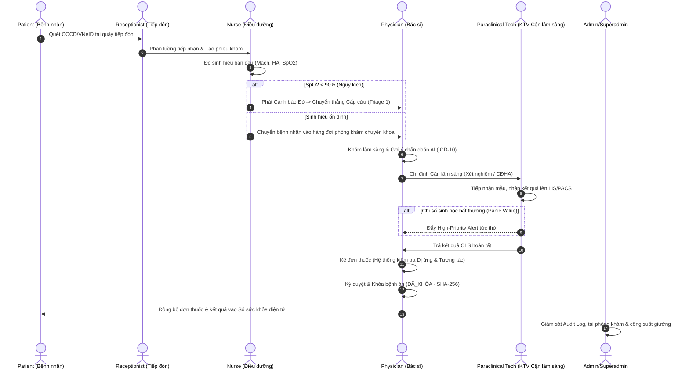

# HPMS (Hospital & Patient Healthcare Management System) Design System
**Version:** 2.1.0 • **Domain:** Healthcare EMR/EHR (Hồ sơ bệnh án điện tử) • **Compliance:** Thông tư 46/2018/TT-BYT & WCAG 2.2 AAA

> **HIERARCHICAL GOVERNANCE:** When building or maintaining a specific sub-module, first check `design-system/hpms/pages/[page-name].md`.
> If that file exists, its specialized rules and component specs **override** this Master file.
> If not, strictly adhere to the standards outlined below.

---

## 1. Design Philosophy: "Clinical Precision & Accessible Elegance"
*(Triết lý thiết kế: Chính xác lâm sàng & Thanh lịch khả dụng)*

Healthcare applications demand an uncompromising standard of patient safety, high data density (*mật độ thông tin cao*), rapid scanability, and zero cognitive ambiguity (*giảm thiểu tối đa sự mơ hồ về mặt nhận thức*).
HPMS serves **7 distinct user roles**, each operating under different physical environments, cognitive loads, and security clearances (*mức độ cấp phép an ninh*).

HPMS harmonizes:
1. **Accessible & Ethical Foundation (WCAG 2.2 AAA)**: Text contrast $\ge 7:1$ for numerical vitals and alerts, $\ge 4.5:1$ for body copy. Non-reliance on color alone (symbol + text + color).
2. **Swiss Modernism 2.0 Structure**: Strict 8px modular spatial grid, clear visual hierarchy, disciplined alignment, high information density without visual clutter.
3. **Role-Adaptive Ergonomics**: Tailored layout density and color coding for each of the 7 business roles (from high-density clinical workstations for Physicians to approachable consumer touch interfaces for Patients).
4. **Subtle Clinical Depth**: Deep medical cyan accents, serene slate backdrops, crisp 1px borders (`#E2E8F0`), micro-elevation shadows, and a dedicated low-glare Night Duty mode (*chế độ trực đêm* cho khoa hồi sức và buồng bệnh nội trú).

---

## 2. 7-Role Architecture & Business Taxonomy
*(Kiến trúc 7 Vai trò & Phân định Nghiệp vụ)*

HPMS enforces strict Role-Based Access Control (RBAC — *Kiểm soát truy cập dựa trên vai trò*). Each role has a distinct visual badge, UI density profile, and functional responsibility across the patient care continuum (*chuỗi chăm sóc sức khỏe liên tục*).

| Role Key | Role Name (VI / EN) | Primary Environment & Hardware | Visual Badge Token | UI Density Profile | Core Business Domain & Responsibilities |
|:---|:---|:---|:---|:---|:---|
| `superadmin` | Quản trị viên cấp cao / Superadmin | IT Office (Desktop 2K/4K) | Purple (`#7C3AED` / `#F5F3FF`) | Compact Analytics | System infrastructure, tenant configuration, cryptographic key management, global RBAC permissions, audit log surveillance (*giám sát nhật ký kiểm toán*), and NEWS2 clinical trigger threshold configuration. |
| `admin` | Quản trị viên bệnh viện / Hospital Admin | KHTH & Operations (Desktop) | Slate Navy (`#1E293B` / `#F1F5F9`) | Dense Dashboard | Bed occupancy quotas (*công suất giường bệnh*), clinic shift rosters, ICD-10 & medication formularies (*danh mục thuốc*), service pricing, clinic queue overload management (>40 patients/shift). |
| `physician` | Bác sĩ khám chữa bệnh / Physician | Consultation Room & Ward (Desktop/Tablet) | Deep Cyan (`#0E7490` / `#ECFEFF`) | Clinical Workstation | Outpatient diagnosis (ICD-10 autocomplete), AI diagnostic suggestions, paraclinical (CLS) order placement, electronic prescribing with allergy/interaction interceptors, inpatient clinical orders (*y lệnh nội trú*), record signing & locking (Thông tư 46/2018/TT-BYT). |
| `nurse` | Điều dưỡng viên / Nurse | Ward Station & Mobile Cart (Tablet/Terminal) | Teal Emerald (`#0D9488` / `#F0FDFA`) | High-Contrast Touch | Initial vital signs intake, periodic NEWS2 vital calculations, ward bed matrix management (*sơ đồ giường bệnh*), critical vital alert receipt, 3-minute escalation protocol response (*xử lý cảnh báo leo thang*), execution of doctor orders. |
| `paraclinical_tech`| Kỹ thuật viên Cận lâm sàng / Paraclinical Technician | Laboratory & Imaging PACS/RIS (Multi-monitor) | Amber Blue (`#0284C7` / `#F0F9FF`) | Specimen Grid | Receiving doctor CLS orders upon financial approval, laboratory test processing, specimen barcode tracking (*theo dõi mã vạch mẫu bệnh phẩm*), image uploading (DICOM/PACS), inputting test results, and raising biological panic values (*chỉ số sinh học báo động*). |
| `receptionist`| Nhân viên tiếp đón / Receptionist | Front Desk Triage (Touch Terminal / Desktop) | Sky Blue (`#0284C7` / `#EFF6FF`) | Fast Triage Entry | Patient check-in via CCCD/VNeID QR scanning, patient demographics matching, automatic creation of new patient health books (`HoSoSucKhoe`), 5-tier triage classification, specialty clinic queue assignment, tracking room capacity thresholds. |
| `patient` | Bệnh nhân & Thân nhân / Patient | Mobile Phone & Consumer Laptop | Clean Emerald (`#059669` / `#ECFDF5`) | Approachable Web | Appointment scheduling by doctor/specialty, accessing personal health records (*sổ sức khỏe điện tử*), viewing plain-language lab results, active medication schedules and pill reminder badges. |

---

## 3. End-to-End Patient Lifecycle & Business Flow Matrix
*(Chu trình khám chữa bệnh & Ma trận phân định trách nhiệm 7 vai trò)*



---

## 4. Color System & Semantic Tokens

### 4.1 Brand & Clinical Base Colors
| Token Name | Hex Code | Tailwind Utility | Semantic Purpose |
|:---|:---|:---|:---|
| `--color-brand-primary` | `#0891B2` | `cyan-600` | Primary clinical actions, active navigation, focus rings |
| `--color-brand-deep` | `#0E7490` | `cyan-700` | High-contrast headers, primary button hover, brand marks |
| `--color-brand-surface` | `#ECFEFF` | `cyan-50` | Active row highlight, primary tint containers, banner backgrounds |
| `--color-brand-secondary`| `#0284C7` | `sky-600` | Secondary metadata links, informative chips |
| `--color-cta` | `#059669` | `emerald-600`| Finalize examination, sign prescription, commit vital entry |

### 4.2 Role Indicator Badges
Every authenticated user's UI displays a role badge in the top navigation bar to prevent accidental operations under wrong user contexts:
- **Superadmin**: `bg-purple-50 text-purple-700 border-purple-200` (Icon: `ShieldCheck`)
- **Admin**: `bg-slate-100 text-slate-800 border-slate-300` (Icon: `BuildingOffice2`)
- **Physician**: `bg-cyan-50 text-cyan-800 border-cyan-300` (Icon: `Stethoscope`)
- **Nurse**: `bg-teal-50 text-teal-800 border-teal-300` (Icon: `HeartPulse`)
- **Paraclinical Tech**: `bg-sky-50 text-sky-800 border-sky-300` (Icon: `Beaker`)
- **Receptionist**: `bg-blue-50 text-blue-800 border-blue-300` (Icon: `Identification`)
- **Patient**: `bg-emerald-50 text-emerald-800 border-emerald-300` (Icon: `UserCircle`)

### 4.3 Clinical Safety & Severity Palette (Hệ thống phân cấp an toàn y tế)
*Strict Rule: Every severity state must combine color, icon SVG, and an explicit text label to guarantee accessibility for color-blind practitioners.*

| Severity Level | Base Hex | Soft Background | Border Hex | Clinical Triggers & Usage |
|:---|:---|:---|:---|:---|
| **Critical / Cấp cứu (Red)** | `#DC2626` | `#FEF2F2` | `#FCA5A5` | $SpO_2 < 90\%$, NEWS2 $\ge 7$, severe drug allergy conflict (*dị ứng sốc phản vệ*), Emergency Triage Level 1 |
| **Urgent / Khẩn cấp (Orange)** | `#EA580C` | `#FFF7ED` | `#FDBA74` | NEWS2 5-6, critical abnormal lab panic value requiring doctor sign-off within 30m |
| **Warning / Theo dõi (Amber)** | `#D97706` | `#FFFBEB` | `#FCD34D` | NEWS2 1-4, moderate drug-drug interaction (*tương tác thuốc trung bình*), clinic load near threshold (>35/40) |
| **Normal / An toàn (Emerald)** | `#059669` | `#ECFDF5` | `#A7F3D0` | Stable vitals, safe medication validation, completed orders |
| **Informational (Blue)** | `#2563EB` | `#EFF6FF` | `#BFDBFE` | Paraclinical (CLS) in progress, pending test results, routine appointment |

### 4.4 Surface & Neutral Scales
- **Light Clinical Mode (Daylight/Clinic)**:
  - Canvas Background: `#F8FAFC` (`slate-50`)
  - Card & Surface: `#FFFFFF` (`white`)
  - Sub-surface / Table Header: `#F1F5F9` (`slate-100`)
  - Border Subtle: `#E2E8F0` (`slate-200`)
  - Border Strong: `#CBD5E1` (`slate-300`)
  - Text Primary: `#0F172A` (`slate-900` — High contrast 13:1)
  - Text Secondary: `#334155` (`slate-700` — WCAG AAA compliant 7.5:1)
  - Text Muted: `#64748B` (`slate-500` — WCAG AA compliant 4.6:1)

- **Night Duty Mode (Phòng trực đêm / ICU Low-light)**:
  - Canvas Background: `#0B1120` (Dark slate navy)
  - Surface: `#111827` (`gray-900`)
  - Elevated Card: `#1F2937` (`gray-800`)
  - Border: `#374151` (`gray-700`)
  - Text Primary: `#F9FAFB` (`gray-50`)
  - Text Secondary: `#9CA3AF` (`gray-400`)

---

## 5. Typography System
Pairing: **Figtree / Inter** (UI & Headings) + **Noto Sans** (Body & Clinical Notes) + **JetBrains Mono / Fira Code** (Clinical Data & Numbers).

```css
@import url('https://fonts.googleapis.com/css2?family=Figtree:wght@400;500;600;700&family=JetBrains+Mono:wght@400;500;600&family=Noto+Sans:wght@400;500;600;700&display=swap');
```

| Type Token | Font Family | Size | Weight | Line Height | Usage |
|:---|:---|:---|:---|:---|:---|
| `display-lg` | Figtree / Sans | `28px` / `1.75rem` | 700 | 1.2 | Emergency triage dashboard titles, primary stats |
| `heading-1` | Figtree / Sans | `22px` / `1.375rem`| 600 | 1.25 | Workstation main page titles, patient full name |
| `heading-2` | Figtree / Sans | `18px` / `1.125rem`| 600 | 1.3 | Panel titles, modal headers, section groups |
| `heading-3` | Figtree / Sans | `15px` / `0.9375rem`| 600 | 1.35 | Widget headers, table group labels |
| `body-md` | Noto Sans / Sans | `14px` / `0.875rem`| 400/500 | 1.45 | Standard clinical notes, descriptions, form labels |
| `body-sm` | Noto Sans / Sans | `12px` / `0.75rem` | 400/500 | 1.4 | Timestamps, secondary patient identifiers, table rows |
| `clinical-mono`| JetBrains Mono | `13px` / `0.8125rem`| 500/600| 1.3 | Vitals ($120/80$), ICD-10 codes, Drug dosages, SHA-256 hash |

> **Typography Critical Rule:** All numeric vital readouts, lab numbers, and blood pressure figures MUST use `font-variant-numeric: tabular-nums` or `font-mono` to prevent visual jitter during real-time streaming updates (*chữ số có bề ngang cố định chống giật màn hình khi cập nhật chỉ số tức thời*).

---

## 6. Role-Specific UI Density & Ergonomics
*(Mật độ giao diện và Công thái học theo từng vai trò)*

1. **Physician Workstation (Compact Clinical Density)**:
   - 3-column split view (Patient queue, Clinical canvas, Order pad).
   - Minimizes scrolling; all high-frequency clinical tools within single-click reach.
   - Dedicated keyboard accelerators (`Alt+S` Lưu khám, `Alt+P` Kê đơn, `Alt+K` Ký duyệt).
2. **Nurse Ward & Telemetry Monitor (High-Contrast Touch Optimized)**:
   - Bento Grid card layout for patient beds.
   - Touch targets $\ge 48\times 48\text{px}$ for tablet interaction during ward rounds.
   - High-contrast alert beacons for viewing from across a 10-meter nursing station.
3. **Paraclinical Technician Lab Bench (Dual-Pane Validation Grid)**:
   - Left pane: Specimen worklist sorted by priority (Emergency vs Routine).
   - Right pane: Structured parameter entry table with automated normal-range comparison flags (L: Low, H: High, Critical Panic).
4. **Receptionist Triage (Zero-Friction Fast Entry)**:
   - Scanner auto-focus listener; single-screen queue distribution.
   - Color-coded clinic capacity gauges with 1-click alternate room reassignment.
5. **Patient Portal (Accessible Consumer Web)**:
   - Large fonts ($16\text{px}$ body), generous line spacing ($1.6$), friendly explanations of lab metrics.
   - High-contrast touch targets for elderly patients.

---

## 7. Security Boundaries, Privacy Masking & TT 46/2018/TT-BYT Compliance
*(Ranh giới bảo mật, Che giấu dữ liệu nhạy cảm & Tuân thủ pháp lý)*

| Security Dimension | Business Rule | Design System Implementation |
|:---|:---|:---|
| **PII Data Masking** (*Che dấu thông tin định danh*) | Public screens, receptionist queues, and shared monitors must not expose full citizen ID or phone numbers. | Mask middle digits: `0010******45` for CCCD, `098***4321` for Phone. Only Physician and Admin with explicit authorization can toggle unmask with audit log recording. |
| **Field-Level Access Control** (*Kiểm soát quyền truy cập trường dữ liệu*) | Receptionists cannot view clinical diagnoses; Technicians cannot edit prescriptions; Patients only view their own records. | Unauthorized fields are omitted completely from the DOM, never merely hidden via CSS (`display: none`). |
| **Inactivity Session Lockout** (*Khóa phiên bất hoạt 15 phút*) | System automatically logs out unattended clinical workstations after 15 minutes of inactivity to prevent unauthorized access. | Floating warning modal at 14:00 with 60-second countdown and quick PIN re-authentication to prevent unsaved note loss. |
| **Record Locking & Hashing** (*Khóa hồ sơ & Băm dữ liệu*) | Completed examinations are locked permanently into read-only state. | Locked badge with SHA-256 fingerprint tooltip. All form controls switch to disabled read-only styling (`bg-slate-50 cursor-not-allowed`). |
| **Audit Trail Protocol** (*Nhật ký ghi vết*) | Any post-signing modification requires an independent "Phiếu điều chỉnh bổ sung". | "Tạo Phiếu bổ sung" modal requiring doctor's credentials and mandatory clinical justification. |

---

## 8. Pre-Flight Clinical Design Checklist
- [ ] Role indicator badge clearly rendered in main navigation header.
- [ ] Text contrast verified with WebAIM / Axe for both Day and Night modes.
- [ ] All table data columns support keyboard navigation and sorting indicators.
- [ ] Autocomplete queries implement 200ms debounce with visual loading state.
- [ ] All action triggers have visible `:focus-visible` rings (`outline: 2px solid #0891B2, outline-offset: 2px`).
- [ ] Critical action buttons require dual-step confirmation or explicit undo capabilities.
- [ ] Sensitive patient PII masked on non-confidential public views.
- [ ] Tabular figures activated for all vital signs and numerical laboratory metrics.
